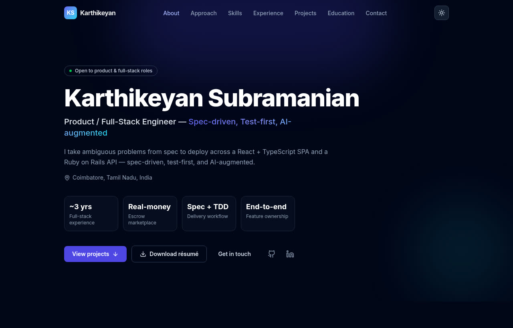

<div align="center">

# Karthikeyan Subramanian — Developer Portfolio

**A fast, accessible, test-backed single-page portfolio — React 19 + TypeScript + Vite + Tailwind v4, ~77 KB gzip.**

<br />

[](https://karthik1210100.github.io/portfolio_2026/)
&nbsp;
[](https://github.com/karthik1210100/portfolio_2026/actions/workflows/ci.yml)
&nbsp;
[](https://www.typescriptlang.org)
&nbsp;
[](LICENSE)

### 👉 [**View the live site**](https://karthik1210100.github.io/portfolio_2026/)

<br />

<a href="https://karthik1210100.github.io/portfolio_2026/"></a>

</div>

Personal portfolio for **Karthikeyan Subramanian** — Full-Stack Developer (Rails + React / TypeScript). A single-page site built with the same stack it talks about — React + TypeScript + Bun, Vite and Tailwind CSS v4 — spec-first in spirit and backed by tests, mirroring the engineering approach it describes.

---

## Why it's built this way

| Goal | How it's achieved |
| --- | --- |
| **Maintainable** | All content lives in one typed model — [`src/data/resume.ts`](src/data/resume.ts). Editing the CV never means editing a component. |
| **Reusable** | Small composable UI primitives (`Section`, `SectionHeading`, `Pill`, `Reveal`, `Icon`) are shared across every section. |
| **Scalable** | Clear separation: `types` → `data` → `hooks` → `components/{ui,layout,sections}`. Adding a section is a data edit plus one component. |
| **Optimised** | No animation library — a reusable `IntersectionObserver` reveal hook. Tree-shaken icons, code-split vendor chunk, ~77 KB gzip JS. |
| **Accessible** | Semantic landmarks, skip link, visible focus rings, `aria-current` nav, and full `prefers-reduced-motion` support. |
| **Test-first** | Vitest + Testing Library cover the data contract and key components, so a bad content edit fails CI instead of shipping. |
| **Themed** | Light/dark with no flash-of-wrong-theme (resolved before paint), tokenised brand colors in one place. |

## Tech stack

- **Runtime / package manager:** [Bun](https://bun.sh) 1.x
- **Framework:** React 19 + TypeScript 5 (strict)
- **Build:** Vite 6
- **Styling:** Tailwind CSS v4 (CSS-first `@theme` tokens, class-based dark mode)
- **Icons:** lucide-react
- **Testing:** Vitest + @testing-library/react + jsdom

## Getting started

```bash
bun install      # install dependencies
bun run dev      # start the dev server (http://localhost:5173)
```

## Scripts

```bash
bun run dev        # Vite dev server with HMR
bun run build      # type-check (tsc -b) + production build to dist/
bun run preview    # serve the production build locally
bun run lint       # type-check only (tsc -b --noEmit)
bun run test       # run the Vitest suite once
bun run test:watch # run tests in watch mode
```

## Project structure

```
src/
├── main.tsx                  # app entry
├── App.tsx                   # page composition (section order)
├── index.css                 # Tailwind + design tokens + reveal keyframes
├── config/navigation.ts      # single source for nav items + section ids
├── types/resume.ts           # content contract (interfaces)
├── data/resume.ts            # THE content — one source of truth
├── lib/cn.ts                 # class-name helper
├── hooks/
│   ├── useTheme.ts           # DOM-synced light/dark state
│   ├── useReveal.ts          # IntersectionObserver scroll-reveal
│   └── useActiveSection.ts   # active nav highlighting
└── components/
    ├── ui/                   # Section, SectionHeading, Pill, Reveal, Icon
    ├── layout/               # Navbar, Footer, ThemeToggle
    └── sections/             # Hero, About, Approach, Skills, Experience,
                              #   Projects, Education, Contact
```

## Editing content

Everything the page renders comes from `src/data/resume.ts`, checked against the
`Resume` contract in `src/types/resume.ts`. Change a role, add a project or a
skill group there and the UI updates — the compiler and the data-contract tests
(`src/data/resume.test.ts`) catch typos, broken links and empty sections.

## Résumé PDF

The hero's **Download résumé** button serves a static PDF from
`public/Karthikeyan-Subramanian-Resume.pdf` (available at the site root). It's
generated from the HTML source of record at [`resume/resume.html`](resume/resume.html):

```bash
bun run resume:pdf   # renders resume/resume.html -> public/…Resume.pdf (needs Playwright)
```

Edit `resume/resume.html` and re-run the script to refresh the PDF. The link and
suggested filename live in the content model (`profile.resumeUrl` /
`profile.resumeFileName`), so the UI stays in sync.

## Deployment

The build is fully static — `bun run build` emits `dist/`, deployable to any
static host. No server or runtime environment variables required.

### GitHub Pages (automated)

Pushing to `main` runs [`.github/workflows/deploy.yml`](.github/workflows/deploy.yml),
which type-checks, tests, builds and publishes to GitHub Pages via the official
Actions pipeline (`configure-pages` → `upload-pages-artifact` → `deploy-pages`).

- **Live URL:** `https://karthik1210100.github.io/portfolio_2026/`
- The build is served from the project subpath. `VITE_BASE` is set to
  `/<repo>/` in the workflow, and every asset URL — including the résumé PDF
  link, built from `import.meta.env.BASE_URL` — resolves under that base. Local
  `bun run dev` / `build` stay at `/`.

**One-time setup:** in **Settings → Pages → Build and deployment**, set
**Source** to **GitHub Actions**. The workflow attempts to enable this
automatically (`configure-pages` with `enablement: true`); if the first run is
blocked on permissions, flip the setting and re-run the workflow.

### Other static hosts

`dist/` also deploys as-is to Netlify, Vercel, S3 + CloudFront or nginx. For a
root-domain host, no `VITE_BASE` is needed (defaults to `/`).
